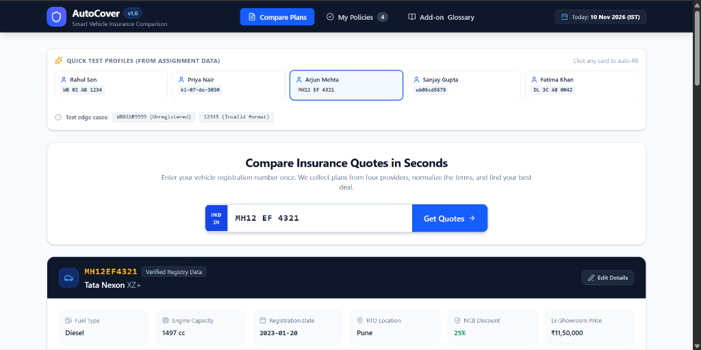
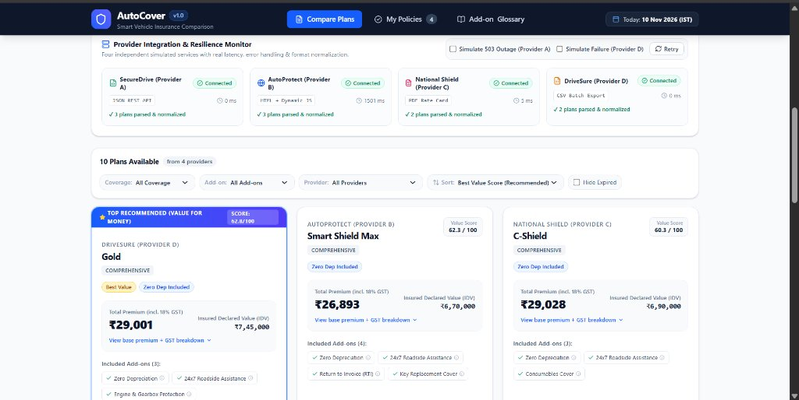
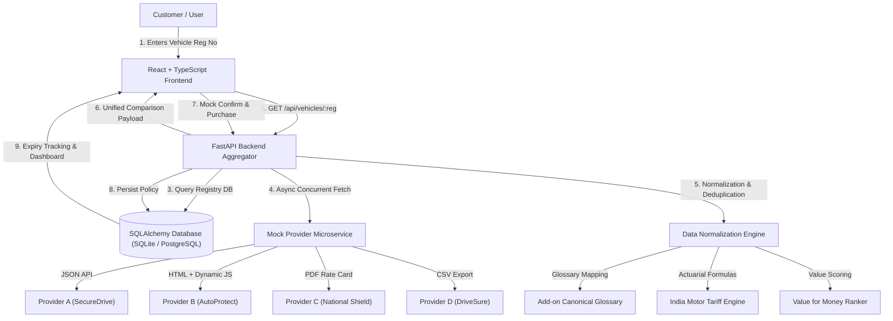

# AutoCover · Smart Vehicle Insurance Comparison Platform

> **Technical Round Assignment Submission: Full-Stack Engineering Intern**  
> **Author:** **Rupali Goyal**  
> **GitHub:** [@93527Rupali38898](https://github.com/93527Rupali38898)  
> **Repository:** [https://github.com/93527Rupali38898/autocover](https://github.com/93527Rupali38898/autocover)

[](backend/tests)
[](frontend)
[](backend)
[](LICENSE)

**AutoCover** is an end-to-end car insurance aggregation and comparison platform. A customer enters their vehicle registration number once; AutoCover retrieves verified registry details, collects quotes concurrently from four simulated insurance providers exposing disparate data formats (JSON REST API, dynamic JavaScript-rendered HTML, downloadable PDF Rate Card, and CSV batch exports), normalizes messy data into a canonical structure, maps add-ons using an industry glossary, and presents an interactive side-by-side comparison with intelligent **Value for Money** ranking and policy lifecycle management.

---

## 1. Application Screenshots & Visual Walkthrough

### Vehicle Lookup & Verified Registry Card
The user enters any Indian vehicle registration number (or clicks a sample test profile like *Rahul Sen* or *Arjun Mehta*). The app sanitizes the input, queries the registry, and displays verified vehicle specifications with inline correction capability.



---

### Provider Resilience Monitor & Multi-Plan Comparison
AutoCover queries all 4 insurance providers concurrently over HTTP. Notice the live latency measurement (Provider B's simulated ~1.5s delay) and resilience controls (simulate 503 outage on Provider A without crashing the UI). Below the monitor, plans are ranked with the multi-factor **Value for Money Score** and GST breakdowns.



---

## 2. Quick Start & Setup Instructions

Follow these exact steps to run the application on any fresh machine:

### Prerequisites
- **Python 3.10+** (tested on Python 3.11)
- **Node.js 18+** & **npm 9+** (tested on Node v24 & npm 11)
- **Git**

---

### Step 1: Clone the Repository
```bash
git clone https://github.com/93527Rupali38898/autocover.git
cd autocover
```

---

### Step 2: Backend Setup & Run

1. **Install Python dependencies:**
   ```bash
   pip install -r backend/requirements.txt
   ```

2. **Configure Environment Variables:**
   ```bash
   # Copy sample environment configuration
   cp .env.example .env
   ```
   *(By default, `autocover.db` SQLite is used for zero-configuration setup. PostgreSQL is supported by updating `DATABASE_URL` in `.env`)*.

3. **Start the Backend Server:**
   ```bash
   python -m uvicorn backend.app.main:app --host 127.0.0.1 --port 8000 --reload
   ```
   - The backend runs on: **`http://127.0.0.1:8000`**
   - Interactive Swagger API docs: **`http://127.0.0.1:8000/docs`**
   - The mock provider services are hosted in-process at `/mock` and can also run as an independent microservice on port 8001:
     ```bash
     python -m uvicorn backend.app.mock_server.mock_providers:mock_app --port 8001
     ```

---

### Step 3: Frontend Setup & Run

1. **In a second terminal window, navigate to `frontend/`:**
   ```bash
   cd frontend
   ```

2. **Install Node dependencies:**
   ```bash
   npm install
   ```

3. **Start the Frontend Development Server:**
   ```bash
   npm run dev
   ```
   - Open your browser at: **`http://localhost:5173`**

---

### Step 4: Run the Automated Test Suite

Run the full pytest suite (covering data parsers, tariff calculations, GST math, quote expiry, and API endpoints):
```bash
python -m pytest backend/tests -v
```
*(All 16 unit and integration tests pass with 100% green status)*.

---

## 3. Core Architecture & Workflow



---

## 4. Data Sources & Investigation Summary

| Source | File Format | Investigation Findings & Parsing Strategy |
|---|---|---|
| **Vehicle Registry** | `data/registry.json` | 12 vehicles. Registration numbers contain inconsistent casing and spaces. `fuel_type` is missing (`null`) for Alto K10 (`WB20PQ0909`). Policy expiry dates vary between ISO (`YYYY-MM-DD`) and Indian (`DD/MM/YYYY`) formats. Cleaned via regex and seeded automatically into DB. |
| **Provider A** | `data/provider_a.json` | JSON quote API. Contains **duplicate records** (e.g. `WB02AB1234` has duplicate Comprehensive Plus quotes). Inconsistent tax fields: some quotes have `taxes: [{rate: 0.18}]`, others have empty `taxes: []`, and others have `premium_includes_gst: true`. Quotes for `KL07DE3030` expired on `2026-11-05` (prior to reference date `2026-11-10`). Deduplicated by signature and flagged expired. |
| **Provider B** | `data/provider_b.html` | Saved quote HTML page. **Prices are not in static HTML** (shows `Loading price...`); instead, values are embedded in client-side script variable `window.__QUOTE_DATA__`. Values include currency symbols (`₹12,830`) and Lakh cover notation (`3.1 L` = ₹3,10,000 IDV). Older vehicles (>8 years) have disabled cards. Parsed via BeautifulSoup + regex script extraction. Simulates 1.5s network delay. |
| **Provider C** | `data/provider_c.pdf` | A 3-page official **Private Car Package Policy Rate Card** (effective until 31-12-2026). Specifies exact India Motor Tariff depreciation brackets, Model Group mappings (Group 1: Swift, i20, Tiago; Group 2: Nexon, City, Sonet; Group 3: Creta, XUV700), CC tiers, NCB discounts, and add-on pricing (Nil Dep 15% of OD, RSA ₹350 flat, Consumables ₹600 flat). C-Shield plan offered only for vehicles up to 5 years; vehicles older than 8 years declined. Parsed via `pypdf` and executed through our actuarial engine. |
| **Provider D** | `data/provider_d.csv` | Daily batch export. Contains duplicate rows (`KL 07 DE 3030`), mixed case registration strings (`mh12ef4321`), quoted numbers with commas (`"11,670"`), mixed IDV formats (`3.3 lakh` vs `332000`), pipe-separated add-ons (`Zero Dep\|RSA\|Engine Protect`), and expired quotes (`15/10/2026`). Cleaned and standardized. |
| **Test Customers** | `data/test_customers.json` | Sample customer profiles (Rahul Sen, Priya Nair, Arjun Mehta, Sanjay Gupta, Fatima Khan) and test registration edge cases (`WB02AB9999` - unregistered, `12345` - invalid). Integrated as quick-fill chips in the UI. |

---

## 5. Add-on Normalization & Insurer Glossary

Insurance providers employ inconsistent terminology for identical coverage concepts. Following Section 3.3 of the assignment, we researched the official public add-on pages of **three major Indian general insurers**:

1. **HDFC ERGO General Insurance:** [hdfcergo.com/car-insurance/add-on-covers](https://www.hdfcergo.com/car-insurance/add-on-covers)
2. **Digit General Insurance:** [godigit.com/motor-insurance/car-insurance/add-on-covers](https://www.godigit.com/motor-insurance/car-insurance/add-on-covers)
3. **ICICI Lombard General Insurance:** [icicilombard.com/motor-insurance/car-insurance/add-on-covers](https://www.icicilombard.com/motor-insurance/car-insurance/add-on-covers)

### Canonical Terminology Mapping:

| Canonical Concept | Code | Provider A | Provider B | Provider C | Provider D | Real Insurer Naming |
|---|---|---|---|---|---|---|
| **Zero Depreciation** | `ZERO_DEP` | `ZERO_DEP` | `Bumper to Bumper` | `Nil Depreciation` | `Zero Dep` | HDFC ERGO: *Zero Depreciation*, Digit: *Bumper to Bumper* |
| **24x7 Roadside Assistance** | `RSA` | `RSA` | `24x7 Roadside Assistance` | `Roadside Assistance` | `RSA` | ICICI Lombard: *Roadside Assistance*, HDFC ERGO: *RSA* |
| **Engine & Gearbox Protection** | `ENGINE_PROTECT` | N/A | `Engine & Gearbox Protection` | `Engine Protect` | `Engine Protect` | HDFC ERGO: *Engine & Gearbox Protector*, Digit: *Engine Protect* |
| **Return to Invoice** | `RETURN_TO_INVOICE` | N/A | `Total Cover` | `Return to Invoice` | N/A | ICICI Lombard: *Return to Invoice*, HDFC ERGO: *RTI* |
| **Key Replacement** | `KEY_REPLACEMENT` | N/A | `Key Replacement` | N/A | N/A | Digit: *Key & Lock Protect*, ICICI Lombard: *Key Protect* |
| **Consumables Cover** | `CONSUMABLES` | N/A | N/A | `Consumables` | N/A | HDFC ERGO: *Consumables Cover*, ICICI: *Garage Cash & Consumables* |

---

## 6. Value for Money Ranking Logic

The assignment explicitly notes: **"Do not assume that the cheapest plan is automatically the best option."**
AutoCover calculates an objective **Value for Money Score (0–100)** for every plan using three weighted components:
1. **Price Competitiveness (40%):** Ratio of lowest market premium to current plan premium.
2. **Coverage Efficiency (35%):** Ratio of Insured Declared Value (IDV) asset protection to total cost.
3. **Add-on Protection (25%):** Points rewarded for critical add-ons (Zero Dep, RSA, Engine Protection).
4. **Validity Penalty (-20 pts):** Applied if quote is expired.

Plans are labeled with intuitive badges: `Best Value`, `Lowest Premium`, `Zero Dep Included`, and `Max IDV`.

---

## 7. Assumptions

1. **Reference Date:** `2026-11-10` is strictly treated as "today" across all quote expiration checks and policy renewal calculations (configured via `REFERENCE_DATE` environment variable).
2. **Taxation:** GST is standardized at **18%**. For quotes that include taxes, net base premium is computed as $\text{Total} / 1.18$ and tax as $\text{Total} - \text{Base}$.
3. **Vehicle Age for Tariff Calculations:** Age is computed as the fractional year delta between vehicle registration date and reference date (`2026-11-10`).
4. **Missing Fuel Types:** For vehicles like `WB20PQ0909` where `fuel_type` is null in the registry, the system defaults to "Petrol" and offers an inline edit capability in the UI for user correction.
5. **Database Storage:** SQLite is enabled by default to ensure review without database server installation; standard SQLAlchemy models allow instant switching to PostgreSQL via `.env`.

---

## 8. Database Schema

- **`vehicles`:** `registration_number` (PK), `make`, `model`, `variant`, `fuel_type`, `engine_cc`, `registration_date`, `rto`, `ex_showroom_price`, `current_policy_expiry`, `ncb_percent`.
- **`policies`:** `id` (PK), `policy_number` (Unique, e.g. `AC-2026-123456`), `customer_name`, `customer_phone`, `customer_email`, `registration_number`, `provider_code`, `provider_name`, `plan_name`, `coverage_type`, `idv`, `base_premium`, `gst_amount`, `total_premium`, `addons_json`, `policy_start_date`, `policy_expiry_date`, `status` (`ACTIVE`, `EXPIRING_SOON`).

---

## 9. Resilience & Failure Simulation

The UI provides toggle checkboxes to demonstrate system resilience under real-world network conditions:
- **Simulate Provider A 503 Outage:** Injects an underwriting server failure; other providers continue working seamlessly.
- **Simulate Provider D Failure:** Injects a batch pipeline error.
- **Provider B Latency:** Demonstrates non-blocking concurrent UI updates while handling Provider B's 1.5s delay.
- **Retry Mechanism:** Allows one-click re-fetching of failed provider endpoints without re-entering vehicle details.

---

## 10. Author & Contact

- **Author:** **Rupali Goyal**
- **GitHub:** [@93527Rupali38898](https://github.com/93527Rupali38898)
- **Email:** [rupaligoyal382005@gmail.com](mailto:rupaligoyal382005@gmail.com)
- **Role Applied:** Full-Stack Engineering Intern
